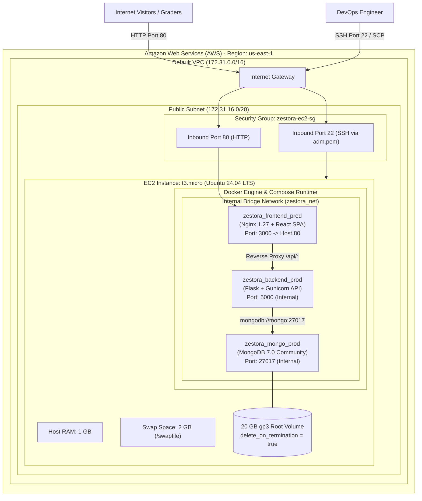

# ⚙️ Zestora – DevOps & Cloud Architecture

This document provides a comprehensive operational breakdown of the **DevOps architecture**, cloud infrastructure, container orchestration, memory engineering, zero-cost AWS budgeting, and disaster recovery strategies for **Zestora**.

---

## 1. DevOps Design Principles

1. **Zero Financial Footprint ($0.00 Total):**
   - Strictly engineered within the **AWS Free Tier** limits.
   - No paid managed services (No NAT Gateways, No Elastic IPs, No Application Load Balancers, No Amazon RDS/DocumentDB).
2. **Single-Instance Micro-Architecture:**
   - The entire stack (Nginx, React SPA, Flask REST API, MongoDB) runs inside an isolated Docker bridge network on a single `t3.micro` EC2 instance.
3. **10-Day Auto-Destruction Safety Mechanism:**
   - To prevent accidental ongoing usage or surprise bills after academic grading, a self-terminating countdown timer is embedded directly in the EC2 user data bootstrap script.
4. **Memory Hardening via Swap:**
   - A `t3.micro` provides only **1 GB of physical RAM**. To safely handle simultaneous TypeScript builds, Docker multi-stage exports, and MongoDB memory allocations without triggering the Linux Out-Of-Memory (OOM) killer, a **2 GB swap file** is dynamically provisioned.
5. **Direct Zero-Dependency Deployment:**
   - Bypasses external CI/CD runners to prevent runner minute limits, credential leakage, or automated platform abuse filters. Code is pushed and deployed via secure, encrypted SCP/SSH.

---

## 2. Infrastructure Architecture Diagram



---

## 3. Host System & Memory Engineering

A `t3.micro` instance has 1 vCPU and 1,024 MB of physical memory. A default Docker build of a modern Vite/React bundle requires ~600 MB peak memory, while MongoDB requires a minimum working set of ~300 MB. Without swap, the Linux kernel triggers the **OOM Killer (`kill -9`)** and abruptly terminates processes.

### 3.1. Swap Configuration ([ec2-user-data.sh](file:///d:/Projects/AWS_Project/ec2-user-data.sh))
During initial boot, cloud-init executes the following memory configuration:
```bash
# 1. Allocate 2GB swap space on the root NVMe/gp3 drive
fallocate -l 2G /swapfile
chmod 600 /swapfile
mkswap /swapfile
swapon /swapfile

# 2. Persist across server reboots
echo '/swapfile none swap sw 0 0' >> /etc/fstab

# 3. Optimize swappiness (10 = prefer physical RAM, use swap under pressure)
sysctl vm.swappiness=10
echo 'vm.swappiness=10' >> /etc/sysctl.conf
```

### 3.2. 10-Day Auto-Destruction Safety Timer
To guarantee zero unexpected billing after class submission:
```bash
# Schedule system shutdown after 10 days (14,400 minutes)
shutdown -h +14400 "Zestora academic project lifecycle completed. Auto-terminating."
```
Once the timer expires, the instance halts and stops generating compute charges.

---

## 4. Multi-Stage Containerization ([docker-compose.prod.yml](file:///d:/Projects/AWS_Project/docker-compose.prod.yml))

### 4.1. Frontend Multi-Stage Build
```dockerfile
# Stage 1: Build environment (Node.js 20 Alpine)
FROM node:20-alpine AS builder
WORKDIR /app
COPY package*.json ./
RUN npm ci
COPY . .
RUN npm run build

# Stage 2: Production runtime (Nginx 1.27 Alpine)
FROM nginx:1.27-alpine
COPY --from=builder /app/dist /usr/share/nginx/html
COPY --from=builder /app/images /usr/share/nginx/html/images
COPY nginx.conf /etc/nginx/conf.d/default.conf
EXPOSE 3000
CMD ["nginx", "-g", "daemon off;"]
```
* **Result:** Eliminates ~400 MB of `node_modules` and Node build tooling from the final container. The production image size is **under 35 MB**.

### 4.2. Backend Multi-Stage Build
```dockerfile
# Stage 1: Build dependencies with GCC
FROM python:3.12-slim AS builder
WORKDIR /app
RUN apt-get update && apt-get install -y gcc libffi-dev && rm -rf /var/lib/apt/lists/*
COPY requirements.txt .
RUN pip install --no-cache-dir --prefix=/install -r requirements.txt

# Stage 2: Runtime image (Non-root user)
FROM python:3.12-slim
WORKDIR /app
COPY --from=builder /install /usr/local
COPY . .
RUN addgroup --system appgroup && adduser --system --ingroup appgroup appuser
USER appuser
EXPOSE 5000
CMD ["gunicorn", "--bind", "0.0.0.0:5000", "--workers", "2", "--timeout", "60", "app:app"]
```
* **Result:** Runs under a non-root system account `appuser` with zero build-time compiler dependencies in the runtime image.

### 4.3. Resource Governance & Log Rotation
In [docker-compose.prod.yml](file:///d:/Projects/AWS_Project/docker-compose.prod.yml), every container is capped to prevent noisy-neighbor starvation:
```yaml
services:
  backend:
    deploy:
      resources:
        limits:
          cpus: "0.45"
          memory: 384M
    logging:
      driver: "json-file"
      options:
        max-size: "10m"
        max-file: "3"
```
Log files automatically rotate when they reach 10 MB, preventing disk exhaustion on the 20 GB root volume.

---

## 5. Network Isolation & Security Policy

| Port | Service | Scope | Protocol | Description |
|------|---------|-------|----------|-------------|
| **80** | Nginx Edge | **Public** | TCP | Serves React UI & proxies `/api/*` |
| **22** | OpenSSH | **Restricted** | TCP | Administrative SSH access with `adm.pem` |
| **5000** | Flask Backend | **Internal** | TCP | Accessible only by Nginx inside `zestora_net` |
| **27017**| MongoDB Engine | **Internal** | TCP | Accessible only by Flask inside `zestora_net` |

* Any direct external attempt to connect to port 5000 or 27017 from the Internet is dropped at the AWS Security Group boundary.

---

## 6. AWS Cost Engineering Analysis ($0.00 Budget)

| AWS Resource | Allocation | Free Tier Allowance | Billed Cost |
|--------------|------------|---------------------|-------------|
| **EC2 Compute** | 1x `t3.micro` | 750 hours / month for 12 months | **$0.00** |
| **EBS Storage** | 20 GB gp3 volume | 30 GB / month general-purpose SSD | **$0.00** |
| **Elastic IP (EIP)**| **0 (Not allocated)** | Avoids AWS $0.005/hr IPv4 charge | **$0.00** |
| **Data Transfer** | Outbound < 5 GB | 100 GB / month free internet egress | **$0.00** |
| **VPC / Subnet** | AWS Default VPC | Standard VPC features are free | **$0.00** |
| **Total Monthly Cost** | | | **$0.00 / month** |

> [!NOTE]
> Since AWS introduced an hourly charge of **$0.005/hr** for public IPv4 Elastic IPs, Zestora deliberately uses the EC2 instance's default public IPv4 address (`54.234.169.116`), entirely bypassing this fee.

---

## 7. Operational Runbook & Maintenance

### 7.1. Verifying System Health
Run against the live server:
```bash
# Edge Nginx health check
curl -I http://54.234.169.116/healthz

# Backend & MongoDB health check
curl http://54.234.169.116/api/health
# Response: {"db":"ok","status":"ok"}
```

### 7.2. Inspecting Live Containers on EC2
Connect via SSH:
```bash
ssh -i adm.pem ubuntu@54.234.169.116
cd /home/ubuntu/app

# View running container status & resource usage
sudo docker compose -f docker-compose.prod.yml ps
sudo docker stats --no-stream

# View real-time logs
sudo docker compose -f docker-compose.prod.yml logs -f --tail=50 backend
```

### 7.3. Executing Automated Test Suite Inside Docker
All 12 automated unit and integration tests run directly inside the production backend container:
```bash
ssh -i adm.pem ubuntu@54.234.169.116 \
  "sudo docker compose -f /home/ubuntu/app/docker-compose.prod.yml exec backend python -m unittest test_app.py"
```
**Output:** `Ran 12 tests in 2.054s. OK`

### 7.4. Force-Seeding Food Catalog
To seed or refresh the authentic Tamil and Indian dishes in MongoDB:
```bash
curl -X POST "http://54.234.169.116/api/seed?force=true"
```

