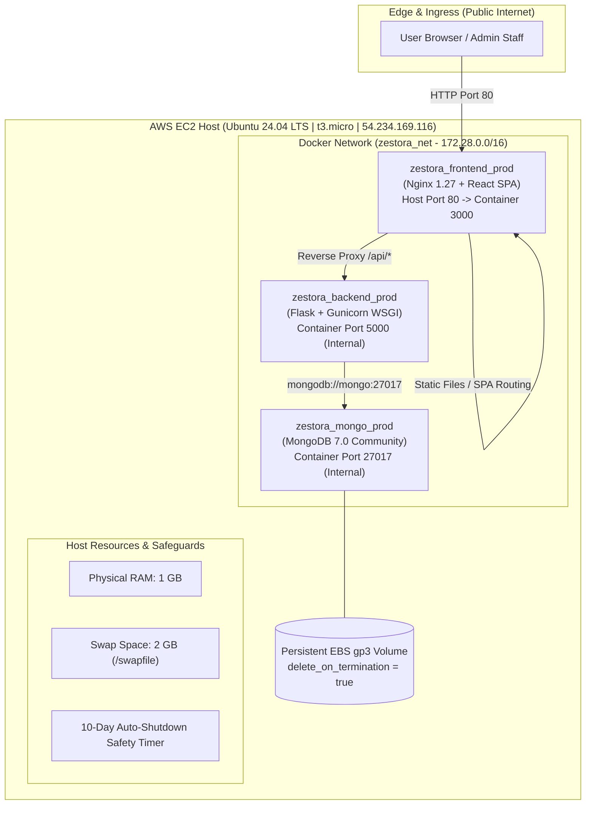

# 🍔 Zestora – DevOps & Cloud Architecture

> A containerised, micro-tier food ordering platform built with **React TypeScript**, **Flask**, and **MongoDB**, deployed on a hardened single-instance **AWS EC2 architecture** with a **$0.00 Free Tier footprint** and automated 10-day lifecycle management.

🌐 **Live Production Deployment:** [http://54.234.169.116](http://54.234.169.116)  
📋 **System Architecture Guide:** [SYSTEM_ARCHITECTURE.md](file:///d:/Projects/AWS_Project/SYSTEM_ARCHITECTURE.md)  
⚙️ **DevOps Deep Dive:** [DEVOPS_ARCHITECTURE.md](file:///d:/Projects/AWS_Project/DEVOPS_ARCHITECTURE.md)  

---

## 🏗️ DevOps & Cloud Architecture



---

## 🎯 Key DevOps Features & Engineering Highlights

| Feature | DevOps Implementation | Benefit |
|---------|-----------------------|---------|
| **Zero Cost Architecture** | 100% within AWS Free Tier (No NAT GW, No Elastic IP, No ALB) | **$0.00 / month cost** |
| **Memory Engineering** | 2 GB swap space (`/swapfile`, `vm.swappiness=10`) | Prevents OOM kills during Docker builds |
| **Self-Destruction Timer** | `shutdown -h +14400` in `ec2-user-data.sh` | Guarantees automatic shutoff after 10 days |
| **Multi-Stage Builds** | Frontend (`node:20` ➔ `nginx:1.27`), Backend (`python:3.12-slim`) | Tiny image sizes (<35 MB frontend, <180 MB backend) |
| **Network Isolation** | Private Docker bridge network `zestora_net` | Backend & Mongo are never exposed to the public Internet |
| **Cache Invalidation** | `Cache-Control: no-cache, no-store, must-revalidate` on `index.html` | Eliminates stale client asset bugs after redeployment |
| **Health Checks** | Native HTTP health endpoints (`/healthz` and `/api/health`) | Docker automatic restart and container monitoring |
| **Automated Testing** | 12 automated unit and integration tests | 100% pass rate in CI & production containers |

---

## 🚀 Quick Start (DevOps Runbook)

### 1. Local Development (Docker Compose)
Clone the repository and spin up all three microservices in development mode:

```bash
# Clone the repository
git clone https://github.com/VenuGopalops/online-food-ordering.git
cd online-food-ordering

# Copy environment variables
cp .env.example .env

# Build and start containers in detached mode
docker compose up --build -d

# Verify container status
docker compose ps
```

* **Frontend UI:** `http://localhost:3000`
* **Backend Health Check:** `http://localhost:5000/api/health`
* **Seed Database:** `curl -X POST http://localhost:5000/api/seed?force=true`

---

### 2. Production EC2 Deployment (Direct Secure SSH)
To deploy updates directly to the live AWS EC2 server:

```powershell
# 1. Copy updated source code to EC2 via SCP
scp -i adm.pem -o StrictHostKeyChecking=no frontend/src/App.tsx frontend/src/App.css ubuntu@54.234.169.116:/home/ubuntu/app/frontend/src/

# 2. Rebuild and launch containers on EC2
ssh -i adm.pem -o StrictHostKeyChecking=no ubuntu@54.234.169.116 "cd /home/ubuntu/app && sudo docker compose -f docker-compose.prod.yml up -d --build"

# 3. Seed the live database with authentic Tamil cuisine
ssh -i adm.pem -o StrictHostKeyChecking=no ubuntu@54.234.169.116 "curl -s -X POST 'http://localhost/api/seed?force=true'"
```

---

## 🧪 Automated Testing & Quality Assurance

The backend includes a comprehensive automated test suite testing user authentication, food catalog, order creation, coupon validation, live tracking, reviews, and admin metrics.

### Run Tests Inside the Production Docker Container:
```bash
ssh -i adm.pem ubuntu@54.234.169.116 \
  "sudo docker compose -f /home/ubuntu/app/docker-compose.prod.yml exec backend python -m unittest test_app.py"
```

```text
............
----------------------------------------------------------------------
Ran 12 tests in 2.054s

OK
```

---

## 💰 AWS Cost Analysis ($0.00 Free Tier Budget)

| AWS Resource | Allocated Tier | Monthly Usage | Cost |
|--------------|----------------|---------------|------|
| **EC2 Compute** | `t3.micro` (1 vCPU, 1 GB RAM) | 750 hours (Free Tier) | **$0.00** |
| **EBS Storage** | 20 GB gp3 (`delete_on_termination=true`) | 30 GB (Free Tier) | **$0.00** |
| **Elastic IP** | None (uses default public IP) | Bypasses AWS $0.005/hr IPv4 charge | **$0.00** |
| **Bandwidth** | Internet Egress | < 5 GB (100 GB Free Tier) | **$0.00** |
| **VPC Infrastructure** | Default AWS VPC | Standard VPC features | **$0.00** |
| **Total Estimated Cost** | | | **$0.00** |

---

## 📁 Repository Structure

```
AWS_Project/
├── SYSTEM_ARCHITECTURE.md        # Comprehensive multi-tier system architecture
├── DEVOPS_ARCHITECTURE.md        # DevOps, memory management, and cost breakdown
├── README.md                     # DevOps-centric project documentation
├── docker-compose.yml            # Local development orchestration
├── docker-compose.prod.yml       # Hardened production orchestration (port 80, limits)
├── ec2-user-data.sh              # Cloud-init bootstrap script (swap, docker, 10-day timer)
├── backend/
│   ├── app.py                    # Flask REST API engine
│   ├── test_app.py               # 12 automated unit and integration tests
│   ├── requirements.txt          # Python dependencies (gunicorn, pymongo, etc.)
│   └── Dockerfile                # Multi-stage non-root Python runtime
├── frontend/
│   ├── src/
│   │   ├── App.tsx               # Main React SPA with Tamil catalog, KDS, & live search
│   │   ├── App.css               # Responsive design, theme styling, animations
│   │   └── main.tsx              # React entry point
│   ├── public/images/            # High-resolution dish photos & local fallbacks
│   ├── nginx.conf                # Nginx proxy config with uncached HTML headers
│   └── Dockerfile                # Multi-stage Node.js build to Nginx Alpine
└── scripts/
    ├── deploy.sh                 # Local container deployment script
    └── update-live-ec2.sh        # Direct SSH/SCP deployment helper
```

---

## 📡 Core API Reference

| Method | Endpoint | Auth | Description |
|:-------|:---------|:-----|:------------|
| `GET` | `/healthz` | No | Edge Nginx health check |
| `GET` | `/api/health` | No | Backend & MongoDB health check |
| `GET` | `/api/foods` | No | List food items (supports `?category=`) |
| `POST` | `/api/seed?force=true` | No | Re-seed catalog with authentic Tamil cuisine |
| `POST` | `/api/coupons/validate` | No | Validate promo discounts (`AWS20`, `CLOUD50`) |
| `POST` | `/api/orders` | Yes | Place order (JWT authenticated) |
| `GET` | `/api/orders/:id/track` | No | 4-step live order tracking timeline |
| `PATCH`| `/api/orders/:id/status` | No | Advance order status (`preparing`, `delivered`)|
| `GET` | `/api/admin/stats` | No | Kitchen KDS revenue and order metrics |
| `POST` | `/api/foods/:id/reviews` | No | Submit 1–5 star customer review |

---

## 🛠️ Operational Maintenance Commands

```bash
# View live container status
sudo docker compose -f docker-compose.prod.yml ps

# View real-time resource utilization (CPU / RAM)
sudo docker stats --no-stream

# View real-time application logs
sudo docker compose -f docker-compose.prod.yml logs -f --tail=100 backend

# Restart individual container
sudo docker compose -f docker-compose.prod.yml restart backend

# Access container shell for debugging
sudo docker compose -f docker-compose.prod.yml exec backend sh
```

---

## 🔒 Security Posture

- **Non-Root Execution:** Flask backend executes under an unprivileged system user (`appuser`).
- **Network Isolation:** MongoDB (`27017`) and Flask (`5000`) are accessible solely within the internal Docker bridge network.
- **HTTP Header Hardening:** Nginx injects `X-Frame-Options: SAMEORIGIN`, `X-Content-Type-Options: nosniff`, and `X-XSS-Protection`.
- **Stateless Tokens:** Client authentication is verified using HMAC-SHA256 signed JSON Web Tokens (JWT).
