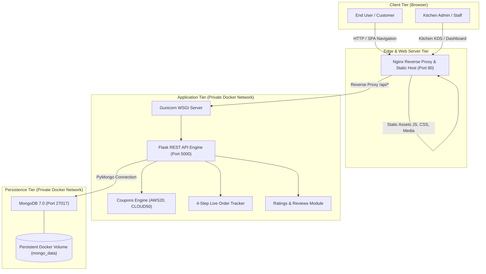
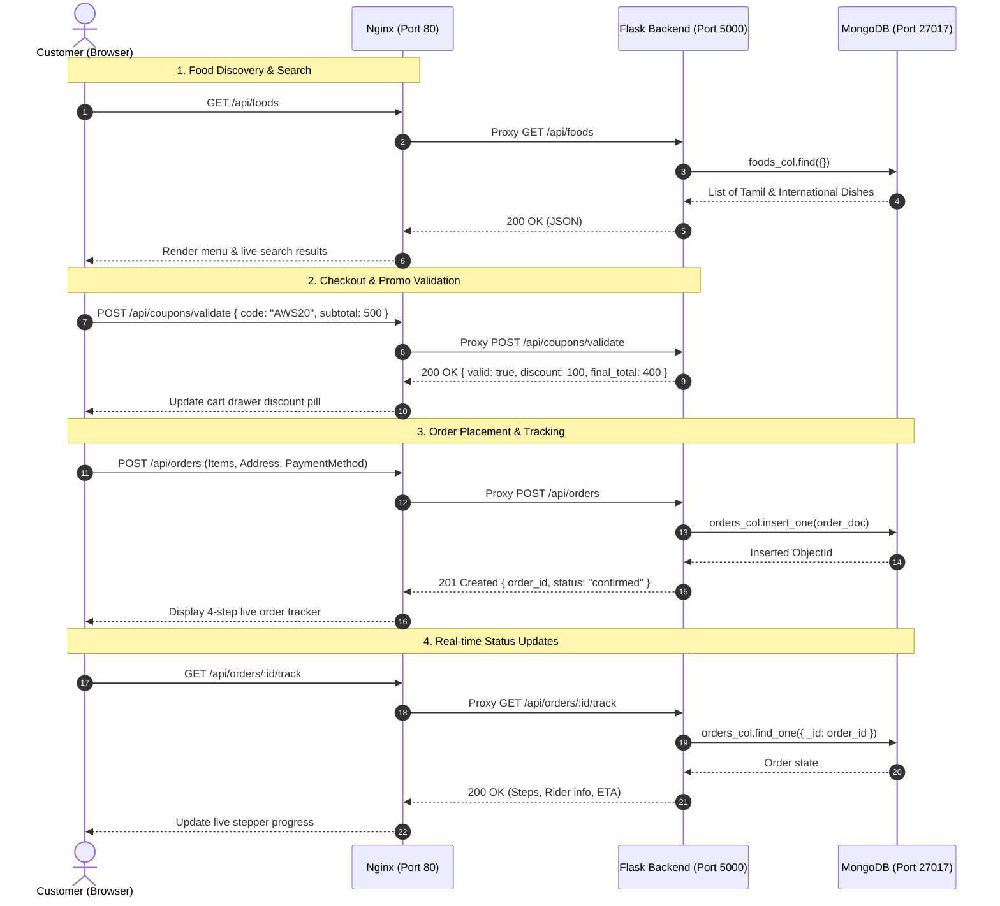
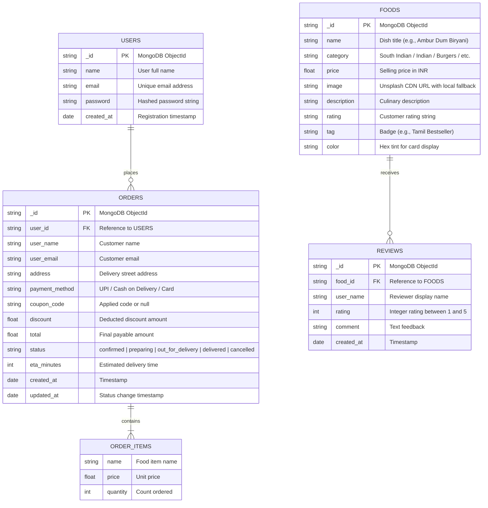

# 🏛️ Zestora – System Architecture

This document provides a detailed architectural breakdown of the **Zestora Online Food Ordering System**, describing its design principles, component tiers, communication protocols, database schema, and security architecture.

---

## 1. High-Level Architecture Overview

Zestora is engineered as a decoupled, multi-tier web application containerized using Docker and deployed to a hardened Linux host on AWS EC2.



---

## 2. Tier-by-Tier Component Specifications

### 2.1. Client Tier (Frontend SPA)
- **Framework & Language:** React 18 with TypeScript.
- **Build Tooling:** Vite 8.3 with `@vitejs/plugin-react` producing an optimized production bundle (`dist/`).
- **State Architecture:**
  - Local reactive state via React hooks (`useState`, `useEffect`, `useMemo`, `useCallback`).
  - Optimistic UI updates for cart items, search filtering, and coupon calculations.
- **User Experience Modules:**
  - **Instant Live Search:** Debounced auto-complete dropdown offering real-time matching across dish names, categories, descriptions, and tags with 1-click `+ Add` actions.
  - **Tamil & Indian Cuisine Catalog:** Categorized catalog featuring authentic Tamil Nadu delicacies (Ambur Biryani, Madurai Bun Parotta, Kothu Parotta, etc.).
  - **Promo Engine Selector:** Instant application of coupon codes (`AWS20`, `CLOUD50`, `FREEDEL`) with real-time subtotal re-calculation.
  - **Live Order Timeline Stepper:** 4-step progress tracker (Confirmed ➔ Kitchen Preparing ➔ Out for Delivery ➔ Delivered) with simulated progression.
  - **Kitchen Display System (KDS):** Dedicated staff dashboard for tracking incoming tickets, viewing revenue metrics, and updating fulfillment states.
  - **Customer Reviews Modal:** Interactive 1–5 star rating and feedback submission.

---

### 2.2. Edge & Web Server Tier (Nginx)
- **Image:** `nginx:1.27-alpine` (lightweight production image, ~25MB).
- **Responsibilities:**
  1. **Static Content Delivery:** Serves pre-compiled HTML, JS chunks, CSS bundles, and image assets.
  2. **Client-Side Routing Fallback:** `try_files $uri $uri/ /index.html` enables seamless React Router / SPA navigation.
  3. **Reverse Proxying:** Forwards all `/api/*` HTTP calls directly to the internal backend container (`http://backend:5000`).
  4. **Cache Invalidation:** Issues strict `Cache-Control: no-cache, no-store, must-revalidate` headers for `index.html` to prevent stale client bundles after new deployments.
  5. **Static Asset Caching:** 1-year immutable caching for fingerprinted assets (`.js`, `.css`, images).
  6. **Security Headers:** Enforces `X-Frame-Options: SAMEORIGIN`, `X-Content-Type-Options: nosniff`, and `X-XSS-Protection`.

---

### 2.3. Application Tier (Backend API)
- **Framework & Language:** Python 3.12 with Flask.
- **WSGI Server:** Gunicorn with multi-threaded worker configuration.
- **API Architecture:** RESTful JSON endpoints following standard HTTP status codes:
  - `200 OK`: Successful retrieval or idempotent update.
  - `201 Created`: Successful resource creation (orders, reviews).
  - `400 Bad Request`: Payload validation failures or invalid coupon codes.
  - `401 Unauthorized`: Missing or invalid JWT credentials.
  - `404 Not Found`: Non-existent order or food ID.
- **Authentication & Authorization:**
  - Stateless JSON Web Tokens (JWT) signed with HMAC-SHA256.
  - Passwords hashed using `werkzeug.security` (`scrypt`/`pbkdf2:sha256`).
- **Resilience:**
  - Automatic MongoDB connection retries with exponential backoff.
  - Graceful degradation when external restaurant APIs are unreachable.

---

### 2.4. Persistence Tier (MongoDB)
- **Engine:** MongoDB 7.0 Community Edition.
- **Storage Strategy:** Persistent Docker named volume `mongo_data` backed by an AWS gp3 EBS volume.
- **Isolation:** Port 27017 is bound strictly to the internal Docker bridge network (`zestora_net`); it is **never** exposed to the public Internet or host network.

---

## 3. Data Flow & Sequence Diagram



---

## 4. Database Schema & Entity Relationships



---

## 5. Security Architecture

1. **Principle of Least Privilege:**
   - The backend Gunicorn process runs under a non-root system user (`appuser:appgroup`).
   - MongoDB is network-isolated and accepts connections exclusively from containers on `zestora_net`.
2. **Data-at-Rest and Data-in-Transit:**
   - Passwords use industry-standard cryptographic hashes with random salt.
   - External asset loading uses strict fallback handlers (`onError` fallback to local assets).
3. **HTTP Armor:**
   - Nginx injects protective HTTP response headers:
     ```nginx
     add_header X-Frame-Options "SAMEORIGIN" always;
     add_header X-Content-Type-Options "nosniff" always;
     add_header X-XSS-Protection "1; mode=block" always;
     add_header Referrer-Policy "strict-origin-when-cross-origin" always;
     ```

---

## 6. Future Scalability Roadmap

For production growth beyond a single instance:
- **Application Tier:** Scale Flask horizontally across an EC2 Auto Scaling Group behind an AWS Application Load Balancer (ALB).
- **Database Tier:** Migrate MongoDB to **Amazon DocumentDB** or **MongoDB Atlas** with multi-AZ replication.
- **Media Delivery:** Distribute static assets and meal photography via **Amazon CloudFront CDN** backed by an **Amazon S3** bucket.

